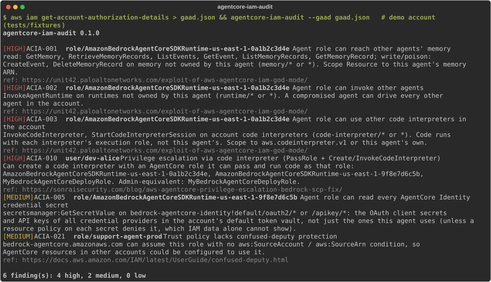

# agentcore-iam-audit

**Find the IAM paths that let one Amazon Bedrock AgentCore agent read or poison another agent's memory, invoke other agents, use their code interpreters, or let a developer run code as a more powerful role.**

[](https://github.com/garag0l/agentcore-iam-audit/actions/workflows/ci.yml)
[](LICENSE)




## Why this exists

- **Agent "God Mode" (Unit 42, April 2026).** Execution roles auto-created by the AgentCore starter toolkit granted access to `memory/*`, `runtime/*`, `code-interpreter/*` and `repository/*`. Any agent could pull another agent's image, find its memory ID, then dump or poison that agent's memory, and invoke any other agent. AWS's answer: the default roles are for development and testing and "should never be used in a production system". The toolkit template was scoped down on 2025-12-09, but roles created before that still exist in accounts. ([Unit 42](https://unit42.paloaltonetworks.com/exploit-of-aws-agentcore-iam-god-mode/))
- **Code-interpreter privilege escalation (Sonrai, 2025).** A principal with `iam:PassRole` + `CreateCodeInterpreter` + `InvokeCodeInterpreter` runs code as the interpreter's role, and CloudTrail attributes the calls to the interpreter, not to the person. ([Sonrai](https://sonraisecurity.com/blog/aws-agentcore-privilege-escalation-bedrock-scp-fix/), [CSA](https://labs.cloudsecurityalliance.org/research/csa-research-note-bedrock-agentcore-enterprise-attack-surfac/))
- **AWS's own managed policy feeds that path.** `BedrockAgentCoreFullAccess` (v21) grants `bedrock-agentcore:*` and `iam:PassRole` on every role whose name contains `BedrockAgentCore`. That includes the toolkit's default roles and any admin role someone named `...BedrockAgentCore...`.

General IAM scanners don't model AgentCore resources. This tool asks the concrete question for each role: *can it reach a resource belonging to a **different** agent?* It evaluates Allow, Deny, NotAction/NotResource and permission boundaries against probe ARNs.

## Install

```bash
pipx install agentcore-iam-audit            # offline mode, zero dependencies
pipx install "agentcore-iam-audit[live]"   # + live mode (boto3)
```

## Usage

```bash
# Offline: no credentials on the machine running the audit
aws iam get-account-authorization-details > gaad.json
agentcore-iam-audit --gaad gaad.json

# Live, read-only: IAM + AgentCore inventory (code interpreters, runtimes, browsers)
agentcore-iam-audit --live --profile audit --region us-east-1 --region us-west-2

# Before deploying: check one execution-role policy (e.g. from CDK/Terraform output)
agentcore-iam-audit --policy role-policy.json --trust trust-policy.json --role-name my-agent-role

agentcore-iam-audit --gaad gaad.json -f json --fail-on medium
```

Live mode needs `iam:GetAccountAuthorizationDetails` plus `bedrock-agentcore:List*`/`Get*` on code interpreters, runtimes and browsers. The AWS managed `SecurityAudit` policy covers the IAM part. Exit code `1` when anything is at or above `--fail-on` (default `high`).

### GitHub Action

Run the audit in CI without managing the install:

```yaml
# Offline: audit a committed/exported GAAD file
- uses: actions/checkout@v5
- uses: garag0l/agentcore-iam-audit@v0.1.2
  with:
    gaad: gaad.json
    fail-on: high

# Live, read-only: configure AWS credentials first, then audit
- uses: aws-actions/configure-aws-credentials@v4
  with: { role-to-assume: arn:aws:iam::111122223333:role/audit, aws-region: us-east-1 }
- uses: garag0l/agentcore-iam-audit@v0.1.2
  with:
    live: "true"
    region: us-east-1
    fail-on: high
```

Provide exactly one source: `gaad`, `policy` (+ optional `trust`), or `live: "true"`.
Other inputs: `format` (text/json), `fail-on` (high/medium/low/none), `version`
(pin the installed PyPI release), `args` (extra flags). The step exits non-zero
when a finding is at or above `fail-on`, failing the job.

## Checks

| ID | Severity | Who | Finding |
|---|---|---|---|
| ACIA-001 | high | agent role | Read or write memory not owned by this agent (memory dump / poisoning) |
| ACIA-002 | high | agent role | `InvokeAgentRuntime` on other agents |
| ACIA-003 | high | agent role | Invoke other code interpreters in the account (code runs as *their* roles) |
| ACIA-004 | medium | agent role | Pull other agents' container images (memory IDs and config inside) |
| ACIA-005 | medium | agent role | `GetSecretValue` on **all** AgentCore Identity credential-provider secrets (`bedrock-agentcore-identity!default/oauth2/*`, `/apikey/*`) |
| ACIA-010 | high / medium | any principal | Privilege escalation: PassRole an AgentCore role + Create/InvokeCodeInterpreter. High when a passable role is admin-equivalent |
| ACIA-011 | medium | any principal | Run code in existing custom code interpreters as their execution roles |
| ACIA-020 | low | agent role | Starter-toolkit default role (`AmazonBedrockAgentCoreSDKRuntime-*`, `...SDKCodeBuild-*`, `AgentCoreEvalsSDK-*`) |
| ACIA-021 | medium | agent role | Trust policy for `bedrock-agentcore.amazonaws.com` without `aws:SourceAccount`/`aws:SourceArn` (confused deputy) |
| ACIA-030 | medium | live | Custom code interpreter with an execution role in `PUBLIC` network mode (credential exfiltration path) |

"Agent role" means a role that `bedrock-agentcore.amazonaws.com` can assume. Findings marked `(conditional)` came from a statement with a Condition the tool didn't evaluate; check it by hand.

## How it was tested

- **Real policy documents, not invented ones:**
  - the starter toolkit's execution-role template from just before the 2025-12-09 scoping fix, and the current version, both rendered with Jinja2 as the toolkit does;
  - its trust policy;
  - AWS's managed `BedrockAgentCoreFullAccess` (v21, from the [MAMIP](https://github.com/z0ph/MAMIP) archive).
- **Results:**
  - The pre-fix role produces every Unit 42 path.
  - The current role produces only ACIA-005 and the default-role notice.
  - A user holding only `BedrockAgentCoreFullAccess` is flagged for escalation to an admin role named `MyBedrockAgentCoreDeployRole`, but not to `prod-admin`.
- **Negative cases:** explicit `Deny` + `NotResource`, a read-only permission boundary, PassRole limited to another service (`iam:PassedToService`), region-scoped policies, and admin principals (nothing to escalate to).
- **Live mode:** tested with botocore's `Stubber`, so every request and response is validated against AWS's real API model for `bedrock-agentcore-control`.
- **CI:** Linux/macOS/Windows × Python 3.11–3.14. CI also rebuilds the account fixture from the source documents and fails if it drifts.

## Limits

- SCPs, resource-based policies and session policies aren't evaluated. A finding means "identity policy allows it". An SCP may still block it, as Sonrai and CSA recommend.
- Conditions other than `iam:PassedToService` are reported, not evaluated.
- "Admin-equivalent" means the role can modify IAM role policies or create user access keys.

## Responsible use

For accounts you own or are authorized to assess. The tool is read-only: offline mode reads a JSON file, and live mode calls only `Get*`/`List*` APIs.

## License

[MIT](LICENSE)
